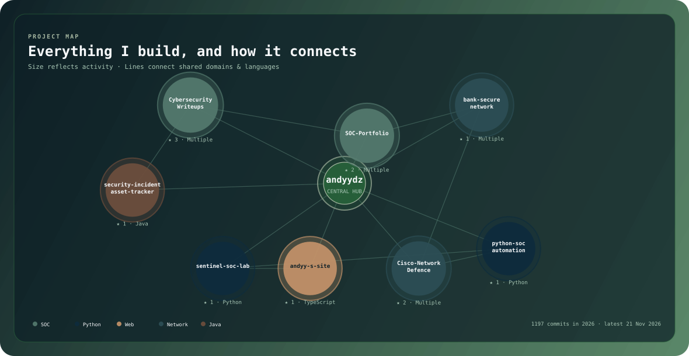

<picture>
  <source media="(prefers-color-scheme: dark)" srcset="./profile-dark.svg?v=3">
  <source media="(prefers-color-scheme: light)" srcset="./profile-light.svg?v=3">
  
</picture>

 

 

##  About

Cybersecurity student building **blue-team expertise** across detection and response, security automation, networking and cloud foundations. I build hands-on experience through SOC labs, Python-based security tools, network security projects and investigation write-ups.

Currently strengthening SIEM operations, log analysis and endpoint security, while developing networking and AWS cloud fundamentals.

**Open to SOC Analyst (L1) and broader blue-team/cybersecurity roles in Hyderabad and Bangalore** (also open to relocation within India).

 [Resume](./Andrew_Vinston_D_Souza_Resume.pdf) · [andyydz57@gmail.com](mailto:andyydz57@gmail.com)

##  Toolkit

**Security:** 

**Also familiar with:** 

**Currently learning:**  · VPC · S3 · EC2

**Programming:** 

· JSON (Wazuh alert parsing)

**Operating systems:** 

**Networking:**  · ping · traceroute · nslookup · VLANs · ACLs · DHCP · DNS

##  Featured projects

| Project | What it is |
| --- | --- |
| [**SENTINEL — SOC Lab**](https://github.com/andyydz/sentinel-soc-lab) | Wazuh 4.14.8 lab with Ubuntu 24.04 endpoints, Kali Linux and real-time `/home/` FIM.  Custom Rules `100002`–`100004` and replayed Windows Sysmon `.evtx` telemetry.  Four documented investigations (`CASE-001`–`CASE-004`) covering SSH brute-force triage and Sysmon replay. **Skills:** SIEM, FIM, detection engineering, incident investigation. |
| [**Python SOC Automation Engine**](https://github.com/andyydz/python-soc-automation) | Python CLI tested with `pytest` for exported Wazuh JSON alerts.  Parses and validates alerts, standardizes timestamps to UTC, checks data quality and optionally verifies SHA-256 integrity.  Optional enrichment uses local rule/severity metadata and MITRE ATT&CK mappings. **Skills:** Python, JSON parsing, pytest, alert automation. |
| [**security-incident-asset-tracker**](https://github.com/andyydz/security-incident-asset-tracker) | Java console application (JDBC + MariaDB) for tracking IT assets and security incidents.  Uses a SOC-oriented data model for incident records and asset information.  **Skills:** Java, SQL databases, incident record keeping. |
| [**Cybersecurity-Writeups**](https://github.com/andyydz/Cybersecurity-Writeups) | Technical TryHackMe write-ups covering Linux, Windows and SOC fundamentals.  Documents lab steps, findings and investigation reasoning.  **Skills:** hands-on analysis, technical documentation. |
| [**bank-secure-network**](https://github.com/andyydz/bank-secure-network) | Cisco Packet Tracer network design for a secure banking environment.  Includes VLAN segmentation, router-on-a-stick, DHCP, DNS, web services and ACL enforcement.  **Skills:** network design, segmentation, access control. |
| [**andyy-s-site**](https://github.com/andyydz/andyy-s-site) | TypeScript portfolio website for cybersecurity projects, SOC investigations and network labs.  Live site: [andyy-s-site.vercel.app](https://andyy-s-site.vercel.app) |

 

 

Zero false positives. Mostly.

 

<picture>
  <source media="(prefers-color-scheme: dark)" srcset="./project-map-dark.svg">
  <source media="(prefers-color-scheme: light)" srcset="./project-map-light.svg">
  
</picture>

  

